<div align="center">

<samp>1988 OBJECTS / 2026 INTELLIGENCE</samp>

# AI System 6

<!-- doc-claims: verified | audited: 2026-11-01 -->

<!-- status:start -->
**Beta 2.0.0-beta.2** · build 20261104.1 · 2026-11-04 · [release notes](https://github.com/surfine/AI-System-6/releases/tag/v2.0.0-beta.2)
<!-- status:end -->

**A local-first writing desk where the AI never becomes your voice.**<br>
One route from your raw questions to a finished piece. Projects in your browser. A stateless server. Two floppy disks.

[](LICENSE)
[](package.json)
[](#built-under-a-1988-constraint)
[](#bring-your-own-model)
[](https://system6.aaronlau.me)
[](https://github.com/surfine/AI-System-6/releases)
[](https://github.com/surfine/AI-System-6/commits/main)

[**BOOT IT NOW**](https://system6.aaronlau.me)&nbsp;&nbsp;·&nbsp;&nbsp;[**THE FILM**](https://www.bilibili.com/video/BV1gYph6hEE6/)&nbsp;&nbsp;·&nbsp;&nbsp;[**PRODUCT SITE**](https://aisystem6.aaronlau.me)&nbsp;&nbsp;·&nbsp;&nbsp;[**MAC BETA**](https://github.com/surfine/AI-System-6/releases/latest)&nbsp;&nbsp;·&nbsp;&nbsp;[简体中文](README.zh-CN.md)

<br>

<a href="https://system6.aaronlau.me"><picture>
  <source media="(prefers-color-scheme: dark)" srcset="site/img/frames/liquid-glass.webp">
  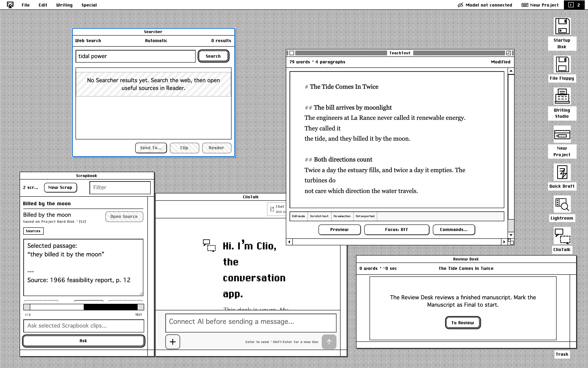
</picture></a>

<sub>YOUR GITHUB THEME JUST PICKED AN ERA: LIGHT IS 1988, DARK IS 2026.<br>
TWELVE APPEARANCES IN ALL. NO MODEL REQUIRED TO LOOK AROUND.</sub>

</div>

<div align="center">

**OPEN A SINGLE WINDOW:** [CMF Studio](https://system6.aaronlau.me/go/cmf-studio) · [Bonsai City](https://system6.aaronlau.me/go/bonsai-city) · [Endfield Terminal](https://system6.aaronlau.me/go/endfield-terminal) · [Time Machine](https://system6.aaronlau.me/go/time-machine) · [OpenTTD](https://system6.aaronlau.me/go/openttd) · [DOOM](https://system6.aaronlau.me/go/doom)

**OR READ A FINISHED DISK:** [the whole shelf, opened on the newest](https://system6.aaronlau.me/go/disks) · [After the Bridge Opens](https://system6.aaronlau.me/go/dtk) · [Why the First iPad Had Only 256MB of Memory](https://system6.aaronlau.me/go/ipad1) · [iPhone 12 Pro Max](https://system6.aaronlau.me/go/pm12)

<sub>EVERY APP HAS ONE SHAREABLE ADDRESS, <code>/go/&lt;app-id&gt;</code>. THE DESK OPENS AROUND IT. THE THIRTY-SIX DEMONSTRATION PROJECT DISKS USE THE SAME ADDRESS RULE, AND THE <b>DEMONSTRATION PROJECT DISKS</b> FOLDER ON THE STARTUP DISK (OR <b>FILE › OPEN DEMONSTRATION PROJECT DISKS…</b>) LISTS EVERY ONE, AND <code>/go/disks</code> OPENS IT READING THE NEWEST.</sub>

</div>

## Contents

- [What's new](#whats-new-in-200-beta2)
- [Run it in 60 seconds](#run-it-in-60-seconds)
- [What this protects](#what-this-protects)
- [What the AI here won't do](#what-the-ai-here-wont-do)
- [The route is the product](#the-route-is-the-product)
- [What the constraint leaves room for](#what-the-constraint-still-leaves-room-for)
- [One desk. Twelve systems.](#one-desk-twelve-systems)
- [Built under a 1988 constraint](#built-under-a-1988-constraint)
- [Bring your own model](#bring-your-own-model)
- [How this repository keeps itself honest](#how-this-repository-keeps-itself-honest)
- [How the repository is laid out](#how-the-repository-is-laid-out)
- [Contributing](#contributing)
- [License](#license)

## What's new in 2.0.0-beta.2

- **First time here offers a finished disk.** A fourth door joins pick a Mac, write one line and the film: read a finished disk opens the demonstration shelf on its newest piece, read-only, and Open a Copy makes it yours, with the whole writing route that disk traveled. No model and no sign-up needed.
- **The AI's discipline is a page anyone can check.** The product site gains [What the AI here won't do](https://aisystem6.aaronlau.me/discipline/): five rules the desk enforces in its own code, each named with the source in the repository that enforces it. The README carries the same list.
- **Bonsai City's budget pane renders again.** The city report, the January budget pane, the tile balloon and the OSM place list had been arriving as escaped text; they are markup again.

The 2.0.0-beta.1 notes, with ClioWork, ClioCode, the three engines, Extensions and the MCP Chooser, are in the changelog below.

The full release history lives in [docs/CHANGELOG.md](docs/CHANGELOG.md); every beta is also on [GitHub Releases](https://github.com/surfine/AI-System-6/releases).

## Run it in 60 seconds

Node 24 or newer. No model is required to look around.

```bash
git clone https://github.com/surfine/AI-System-6.git
cd AI-System-6
npm ci
npm start          # http://localhost:4173
```

Before a pull request, run the same gates CI runs:

```bash
npm run build
npm test
npm run verify:public
```

The Mac beta is packaged from the same source; it is ad-hoc signed and may need **Control-click › Open** on first launch. See the [latest release](https://github.com/surfine/AI-System-6/releases/latest).

## What this protects

AI writing tools tend to do one of two things: they write for you, or they hide where the words came from. This desk takes a third position.

Your raw questions stay yours. The route from question to outline to section drafts to manuscript keeps every source attached to the sentence it supports. AI suggestions arrive as candidates; nothing enters the manuscript until you accept it. The app runs in your browser, the server is stateless, and project state is an IndexedDB database you can export.

The Macintosh System 6 desktop is a **constraint, not the pitch**. It keeps the surface small enough to understand, and it makes the product test itself against a 1988 budget.

## What the AI here won't do

Five rules the desk enforces in its own code, each with a contract that fails if it is quietly removed:

- **It does not pretend to think.** The status line's seven states change only on real run events; Stop appears only when a run can actually stop.
- **It does not hide what it read.** Every model run leaves a receipt (route, retries, citation range), and receipts never store credentials or a chain of thought.
- **It does not become your voice.** Model output stays a candidate until you accept it, and Review Desk checks AI-mouthpiece drift beside facts and structure.
- **It asks before it writes.** In ClioWork and ClioCode, read-only commands run, dangerous ones ask every time, and every call leaves a checkpoint you can rewind to.
- **It runs on your machine, or on the model you name.** With no model the route still completes; the server is stateless and keeps no project database.

The long version, with sources for each rule, is [on the product site](https://aisystem6.aaronlau.me/discipline/); the local and cloud boundary is [docs/LOCAL-AND-CLOUD.md](docs/LOCAL-AND-CLOUD.md).

## The route is the product

```text
Question Sheet → Outline → Section Drafts → Manuscript → Review Desk → Project CD
```

| Stop | What it holds |
| --- | --- |
| **Question Sheet** | your raw questions, notes and source material |
| **Outline** | the argument, in the order you want to make it |
| **Section Drafts** | writing one section at a time, with its sources in view |
| **Manuscript** | the assembled piece, with citations and tracked revisions |
| **Review Desk** | a returned document opened as per-paragraph candidates |
| **Project CD** | the finished, exportable record of the project |

<table>
<tr>
<td>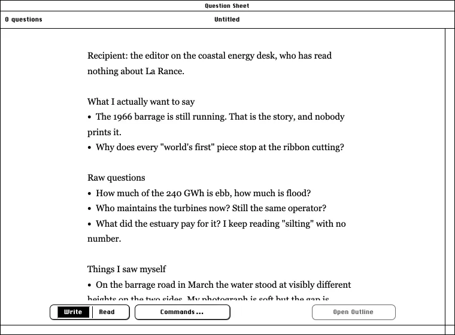</td>
<td>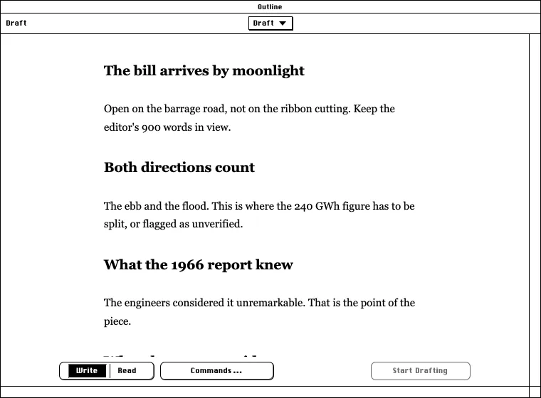</td>
</tr>
<tr>
<td>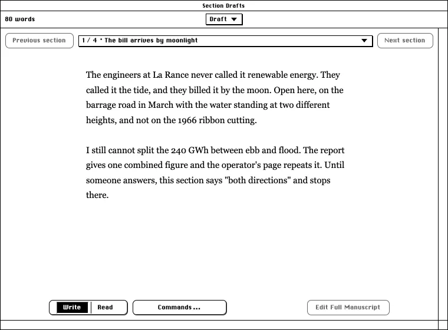</td>
<td>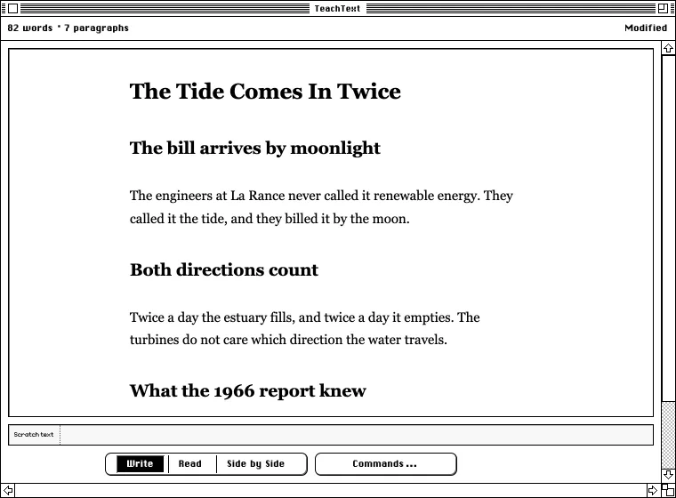</td>
</tr>
</table>

<sub>Captured from the running app; no hand-made marketing art. See `npm run site:capture-route`.</sub>

## What the constraint still leaves room for

|  |  |
| --- | --- |
| 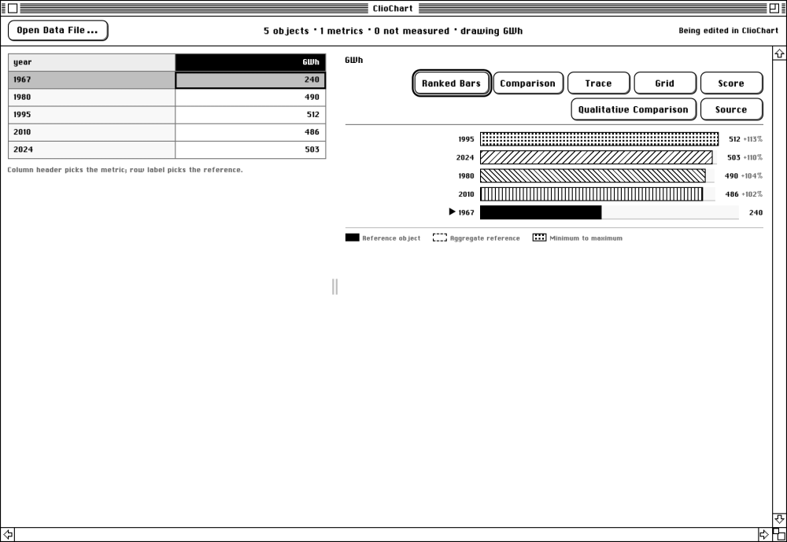 | 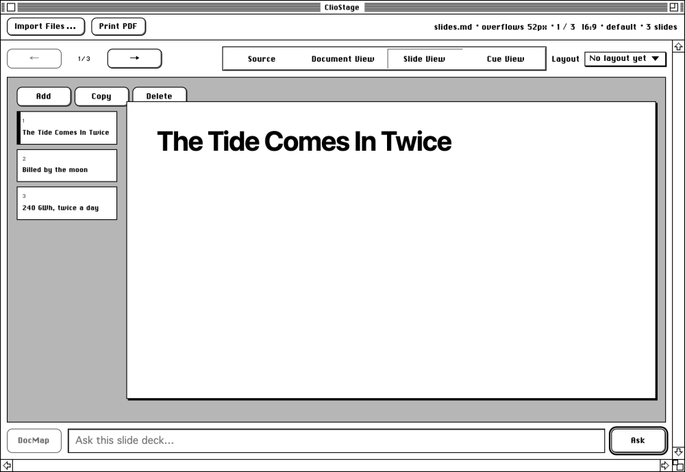 |
| **ClioChart** — sheets with formulas, page setup and PDF print | **ClioStage** — decks with a presenter view and handouts |
| 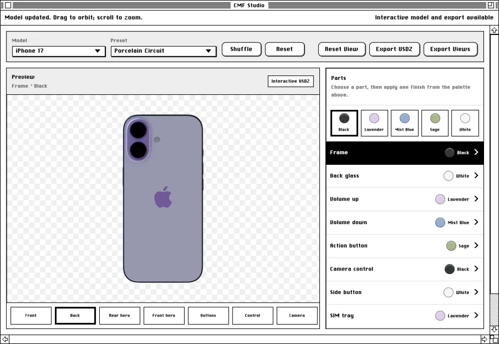 | 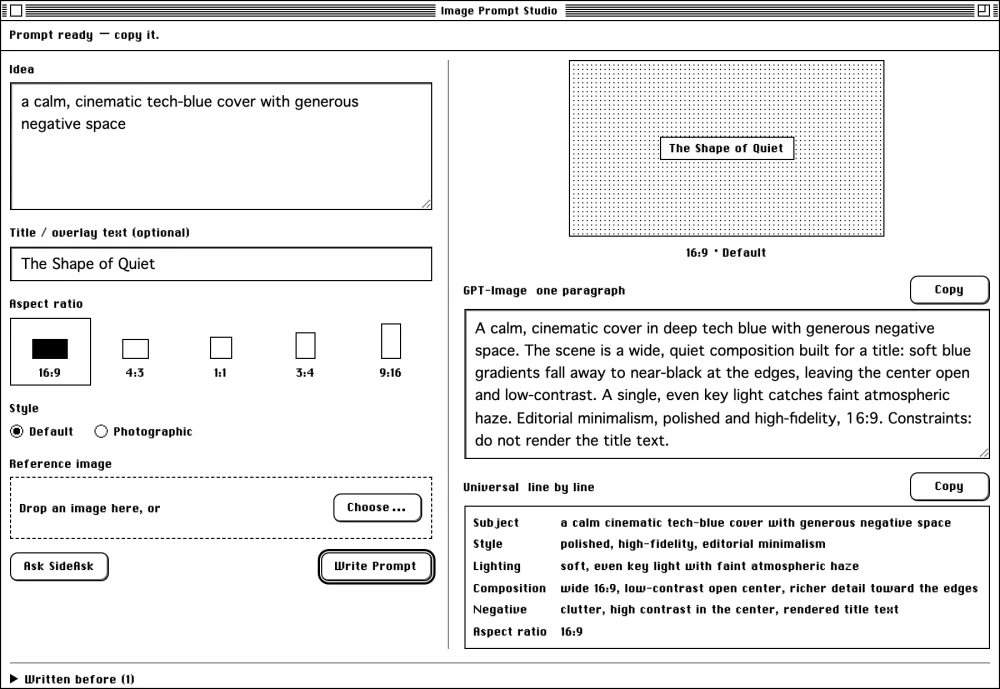 |
| **CMF Studio** — a scene editor inside the desk | **Image Prompt Studio** — prompts, not autopilot |

## One desk. Twelve systems.

<table>
<tr>
<td></td>
<td>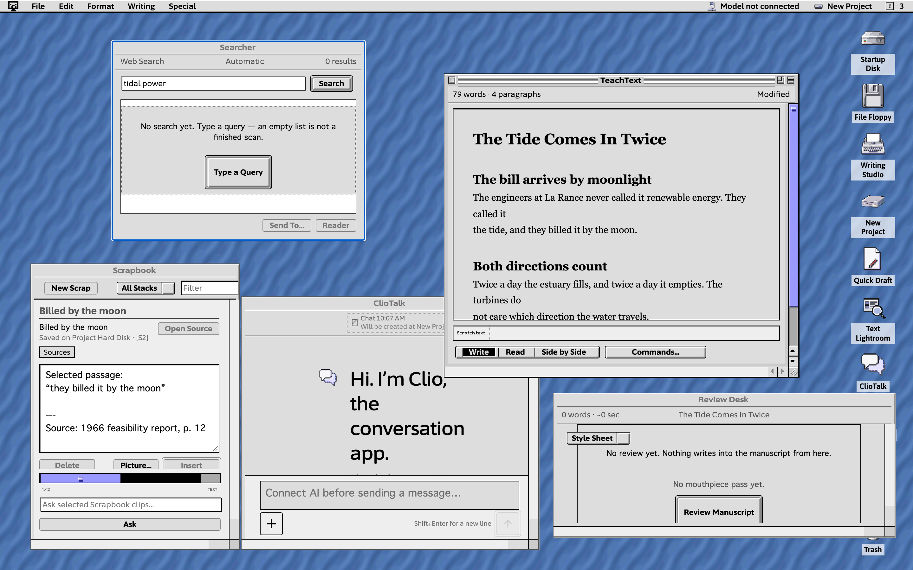</td>
<td>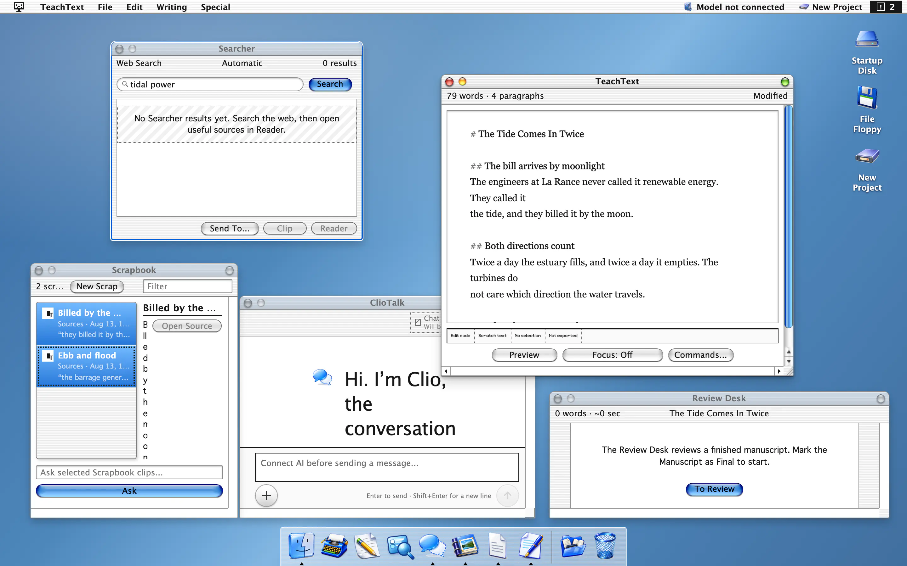</td>
<td>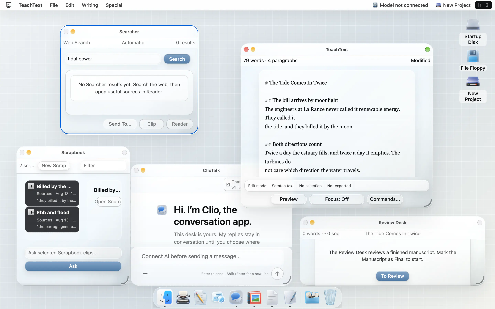</td>
</tr>
</table>

<sub>CLASSIC · PLATINUM · AQUA · LIQUID GLASS — AND EIGHT MORE ON THE <a href="https://aisystem6.aaronlau.me">PRODUCT SITE</a>.</sub>

<p align="center">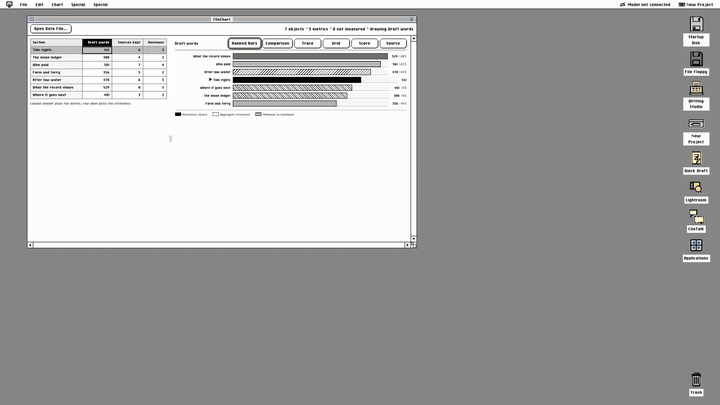</p>

<sub>SAME DESK, SWITCHING ERAS — CAPTURED FROM THE RUNNING APP.</sub>

**Bonsai City** and **One More Tune** are complete applications, not demos: a town that grows from a seed and a music round built on a real deck. **It also runs DOOM** — and OpenTTD, Micropolis and three smaller games — inside the same window model.

<p align="center">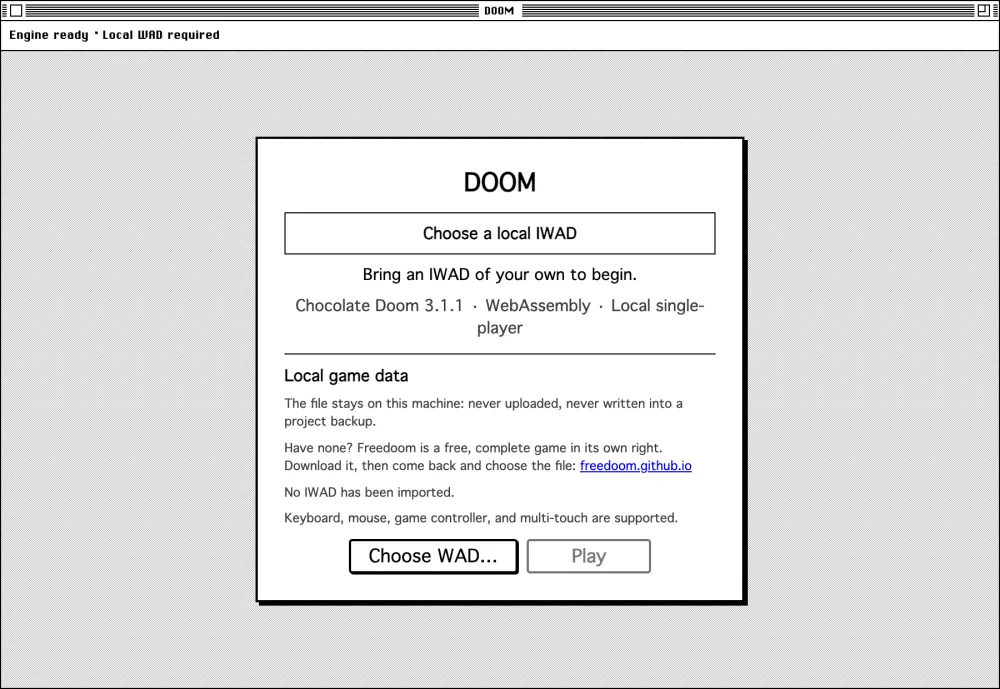</p>

The thirty-six demonstration project disks are one registry, not one file each:
`tooling/build-shared-project-disks.mjs`
is the list a third disk has to join, and
[`tests/features/demo-disks-panel.test.mjs`](tests/features/demo-disks-panel.test.mjs)
is what fails if the list, the Finder row and the site scene disagree.

## Built under a 1988 constraint

```text
boot-critical payload   stays under the System Floppy Budget: 2,959,872 bytes
two 1.44 MB floppies    2,949,120 bytes of capacity, with a reserve the gate keeps
heavy tools             load lazily, from a third disk
```

The release gate measures the files needed to start the desktop. Tools that load on demand, AI models and the demonstration disks are not included. `npm run verify:floppy` refuses a build that crosses the budget; the site reads the measured size from `site/data/floppy-budget.json` and this page does not quote it, because that number changes with every build.

## Bring your own model

| Route | Use it for |
| --- | --- |
| **LM Studio** | local chat, embeddings, discovery, model loading |
| **Ollama** | local OpenAI-compatible serving |
| **DeepSeek** | built-in cloud configuration |
| **Custom endpoint** | any compatible provider and model |
| **No model** | the desktop and every non-AI tool |

Durable project state lives in your browser's IndexedDB. The server is a stateless bridge with no application database. Credentials never enter project files, chats, backups, or exports.

## How this repository keeps itself honest

Claims rot. These run from a fresh clone and fail the build instead.

| Gate | What it refuses to let happen |
| --- | --- |
| `verify:floppy` | the boot payload growing past two 1.44&nbsp;MB floppy disks |
| `site:check` | this page quoting a byte count the gate never measured |
| `verify:docs` | an English document drifting away from its Chinese mirror |
| `verify:public` | a command advertised here that fails from a fresh clone |

Every product screenshot on this page and on the [product site](https://aisystem6.aaronlau.me) is re-shot from the running app by `npm run site:capture-frames`, `npm run site:capture-route`, and `tooling/capture-site-proofs.mjs`. There is no art directory of hand-made marketing images to fall out of date.

## How the repository is laid out

```text
AI-System-6/
├── .github/            issue templates, contribution and security policy
├── apps/
│   ├── desktop/        browser computer: OS services, apps, styles, assets
│   └── server/         stateless Node.js bridge and model adapters
├── docs/               architecture, development, changelog, film source
│   └── film/claude-pop/  film source, scene timing and music tools
├── platform/           macOS shell contracts
├── site/               independently deployable product website
├── tests/              executable product and architecture contracts
├── tooling/            build, verify, capture, package, release
└── vendor/             third-party references, including system.css
```

Read [Architecture](docs/ARCHITECTURE.md), [Development](docs/DEVELOPMENT.md), the [Design Contract](docs/design/DESIGN.md), and the [Changelog](docs/CHANGELOG.md).

## Contributing

Start with [CONTRIBUTING.md](.github/CONTRIBUTING.md), open an issue with a reproducible product contract, or report security problems through [SECURITY.md](.github/SECURITY.md). Every advertised command must work from a fresh clone; the public repository is an independently verifiable source snapshot.

## License

[MIT](LICENSE). Independent project — not affiliated with or endorsed by Apple Inc.

Third-party code and data keep their own licenses. Time Machine's ad blocking ships uBlock Origin Lite's rule lists as data (GPL-3.0); the licence and provenance are in vendor/ubol/.

<div align="center">

  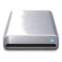 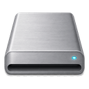 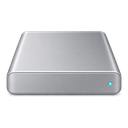 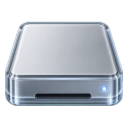

<sub>ONE DISK. TWELVE APPEARANCES. SAME WORK.</sub>

If AI writing tools should leave your voice alone, **[★ star AI System 6](https://github.com/surfine/AI-System-6)**.

[**LIVE DESKTOP**](https://system6.aaronlau.me)&nbsp;&nbsp;·&nbsp;&nbsp;[**BILIBILI FILM**](https://www.bilibili.com/video/BV1gYph6hEE6/)&nbsp;&nbsp;·&nbsp;&nbsp;[**PRODUCT SITE**](https://aisystem6.aaronlau.me)&nbsp;&nbsp;·&nbsp;&nbsp;[**LATEST RELEASE**](https://github.com/surfine/AI-System-6/releases/latest)

</div>

<!-- claim-check: npm run site:check | site/data/floppy-budget.json (the only source of the measured bytes; budget 2959872, written by verify:floppy) | npm run verify:floppy, verify:docs, verify:public | site/img/frames (twelve appearances) | apps/desktop/assets/readme/appearances.gif -->
