<!-- canonical-source: README.md -->
<!-- source-sha256: cd5fbf49620e8b4702b1b73a3d18d9d2c21c1038a1ddd9cd41e8f22d3f8d36a4 -->

> 英文版为准 / 仅供人类参考

<div align="center">

<samp>1988 年的对象 / 2026 年的智能</samp>

# AI System 6

<!-- status:start -->**测试版 2.0.0-beta.1** · 构建 20261101.1 · 2026-11-01 · [发布说明](https://github.com/surfine/AI-System-6/releases/tag/v2.0.0-beta.1)<!-- status:end -->

**一张本地优先的写作桌，AI 永远不会变成你的嗓音。**<br>
从你粗糙的问题到一篇能交出去的稿子，只有一条路线。项目留在浏览器，服务端不留项目。两张软盘。

[](LICENSE)
[](package.json)
[](#在一个-1988-年的约束下建造)
[](#自带模型)
[](https://system6.aaronlau.me)
[](https://github.com/surfine/AI-System-6/releases)
[](https://github.com/surfine/AI-System-6/commits/main)

[**立即启动**](https://system6.aaronlau.me)&nbsp;&nbsp;·&nbsp;&nbsp;[**宣传片**](https://www.bilibili.com/video/BV1gYph6hEE6/)&nbsp;&nbsp;·&nbsp;&nbsp;[**产品官网**](https://aisystem6.aaronlau.me/zh-CN.html)&nbsp;&nbsp;·&nbsp;&nbsp;[**Mac 测试版**](https://github.com/surfine/AI-System-6/releases/latest)&nbsp;&nbsp;·&nbsp;&nbsp;[English](README.md)

<br>

<a href="https://system6.aaronlau.me"><picture>
  <source media="(prefers-color-scheme: dark)" srcset="site/img/frames/liquid-glass.webp">
  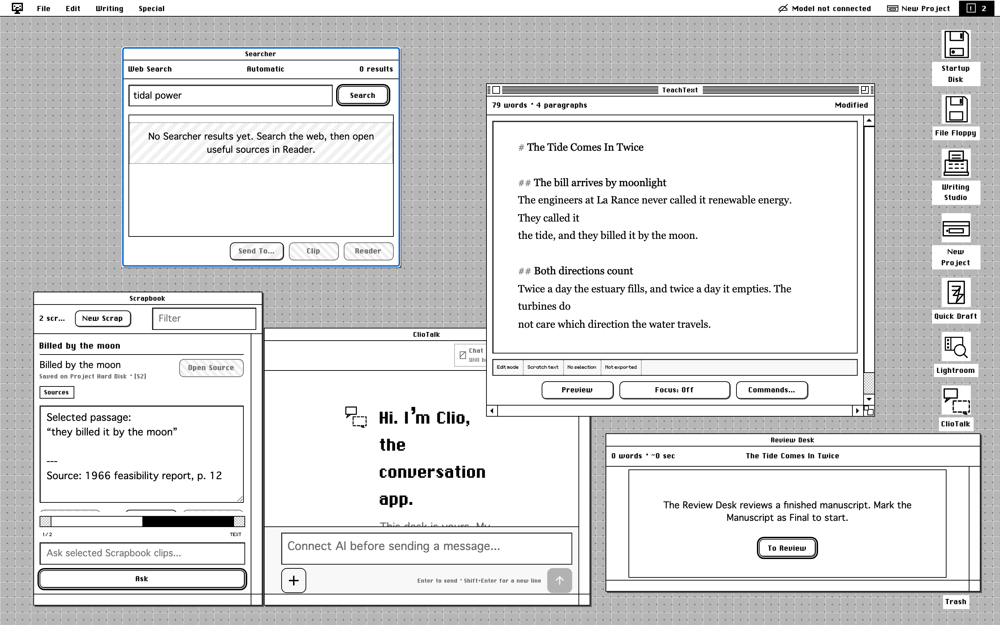
</picture></a>

<sub>你的 GITHUB 主题刚刚替你选好了时代：浅色是 1988，深色是 2026。<br>
一共十二种外观。不需要连接模型也能逛。</sub>

</div>

<div align="center">

**打开一个窗口：** [CMF Studio](https://system6.aaronlau.me/go/cmf-studio) · [Bonsai City](https://system6.aaronlau.me/go/bonsai-city) · [Endfield Terminal](https://system6.aaronlau.me/go/endfield-terminal) · [Time Machine](https://system6.aaronlau.me/go/time-machine) · [OpenTTD](https://system6.aaronlau.me/go/openttd) · [DOOM](https://system6.aaronlau.me/go/doom)

**或者读一块成品盘：** [整排磁盘，从最新一块打开](https://system6.aaronlau.me/go/disks) · [After the Bridge Opens](https://system6.aaronlau.me/go/dtk) · [Why the First iPad Had Only 256MB of Memory](https://system6.aaronlau.me/go/ipad1) · [iPhone 12 Pro Max](https://system6.aaronlau.me/go/pm12)

<sub>每个应用只有一个可分享地址，<code>/go/&lt;app-id&gt;</code>，桌面围绕它打开。三十六块演示项目盘使用同一条地址规则；启动盘上的 <b>演示项目盘</b> 文件夹（或 <b>文件 › 打开演示项目盘…</b>）列出全部，<code>/go/disks</code> 会读取最新的一块。</sub>

</div>

## 目录

- [2.0.0-beta.1 有什么新东西](#200-beta1-有什么新东西)
- [60 秒跑起来](#60-秒跑起来)
- [它保护什么](#它保护什么)
- [路线就是产品](#路线就是产品)
- [约束里还留得下的东西](#约束里还留得下的东西)
- [一张桌，十二个系统](#一张桌十二个系统)
- [在一个 1988 年的约束下建造](#在一个-1988-年的约束下建造)
- [自带模型](#自带模型)
- [这个仓库怎么保持诚实](#这个仓库怎么保持诚实)
- [仓库是怎么摆的](#仓库是怎么摆的)
- [参与贡献](#参与贡献)
- [许可证](#许可证)

## 2.0.0-beta.1 有什么新东西

- **ClioTalk，以及它旁边的 ClioWork 与 ClioCode。** ClioWork 是从 Clio 左栏进入的文档工作室：最多挑三份项目里的 Office 文档，交给 Clio 一个任务，结果带着待处理修订在 Clio 旁边打开。ClioCode 在你授权的代码文件夹里原地工作，权限模式像 Claude Code：只读命令直接跑，危险命令每次都问，引擎在 Seatbelt 沙盒里运行，每次调用都留下可回退的检查点。
- **三个引擎，长任务保留状态。** DeepSeek Harness，加上通过 ACP 接入的 Codex 与 Claude Code；沙盒、文件和每一次权限回答都由桌面保管。任务有进度账本和卡住报告，重启后可以继续，可以从任何完成的回合分叉，也可以把运行中输入的后续排队。
- **Clio 提议要记住什么，你决定。** 技能和记忆按项目或整张桌面由 Clio 提议，只有你接受后才生效；Extensions 窗口负责列出、导出、导入和五个内置角色。
- **Chooser 为 MCP 重新设计。** System 6 驱动栏、MCP 启用/停用开关、每位访客按工具的允许/每次询问/关闭与项目挂载，以及最近调用列表。Clio 可以通过本地网关使用外部连接器，仍然是同样的逐工具选择。
- **更多 Office，以及新的关于本机。** ClioChart 增加函数、页面设置和 PDF 打印；ClioStage 增加动画窗格、切换、备注母版和讲义；ClioWrite 可以编辑页眉、页脚和页码。About This Mac 列出这张桌的事实。
- **写作评测。** `tests/evals` 里有 21 个来自演示盘的真实写作与编辑任务，离线评分器不需要模型。

完整发布历史在 [docs/CHANGELOG.zh-CN.md](docs/CHANGELOG.zh-CN.md)；每个测试版也在 [GitHub Releases](https://github.com/surfine/AI-System-6/releases)。

## 60 秒跑起来

需要 Node 24 或更新版本。只看不玩不需要模型。

```bash
git clone https://github.com/surfine/AI-System-6.git
cd AI-System-6
npm ci
npm start          # http://localhost:4173
```

提 pull request 之前，跑和 CI 相同的门禁：

```bash
npm run build
npm test
npm run verify:public
```

Mac 测试版由同一份源码打包；它是 ad-hoc 签名，首次打开可能需要 **按住 Control 点按 › 打开**。见[最新发布](https://github.com/surfine/AI-System-6/releases/latest)。

## 它保护什么

AI 写作工具通常做两件事之一：替你写，或者藏起字是从哪来的。这张桌取第三种位置。

你粗糙的问题仍然属于你。从问题到提纲、到分节草稿、到正文的路线，让每条来源都贴在它支撑的那句话旁边。AI 的建议以候选形式到达；你不接受，它就不会进入正文。应用在你浏览器里运行，服务端不存项目，项目状态是一个可以导出的 IndexedDB 数据库。

Macintosh System 6 桌面是**约束，不是卖点**。它把表面小到可以理解，也让产品拿 1988 年的预算检验自己。

## 路线就是产品

```text
问题表 → 提纲 → 分节草稿 → 正文 → 审校台 → 项目 CD
```

| 站点 | 它装什么 |
| --- | --- |
| **问题表** | 你粗糙的问题、笔记和来源材料 |
| **提纲** | 你想按什么顺序展开的论证 |
| **分节草稿** | 一次写一节，来源就在旁边 |
| **正文** | 组装好的稿子，带引用与修订 |
| **审校台** | 收回来的文档按段落变成候选 |
| **项目 CD** | 项目完成后的可导出记录 |

<table>
<tr>
<td>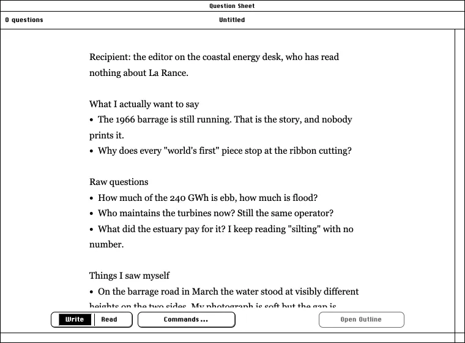</td>
<td>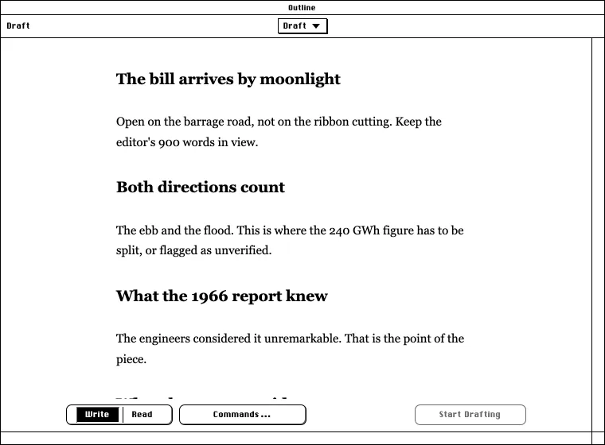</td>
</tr>
<tr>
<td>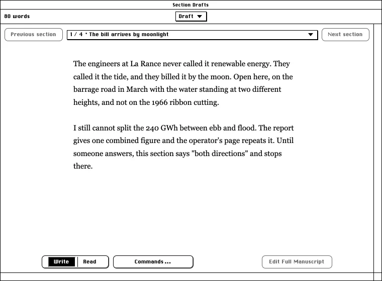</td>
<td>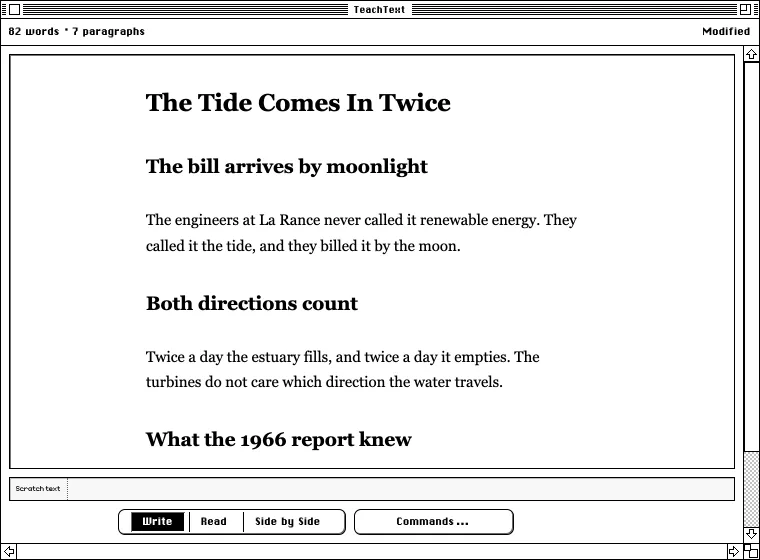</td>
</tr>
</table>

<sub>全部从运行中的应用捕获，没有手制营销图。见 `npm run site:capture-route`。</sub>

## 约束里还留得下的东西

|  |  |
| --- | --- |
| 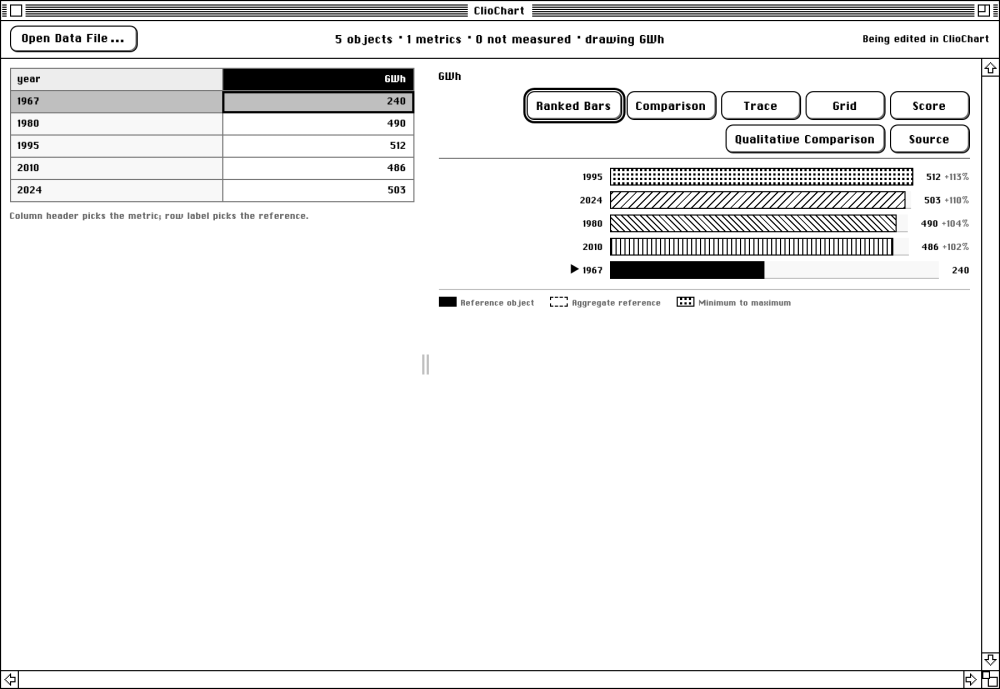 | 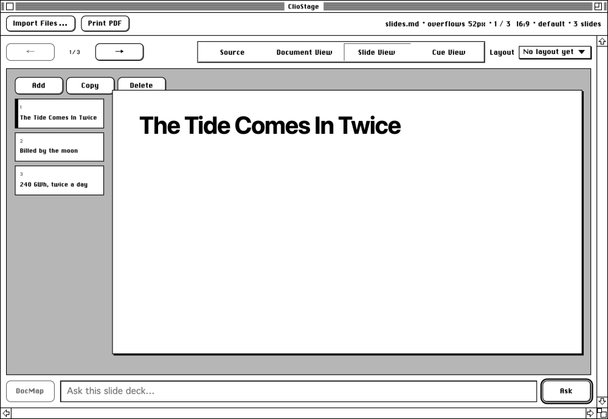 |
| **ClioChart** — 带公式、页面设置与 PDF 打印的表格 | **ClioStage** — 带演讲者视图与讲义的幻灯片 |
| 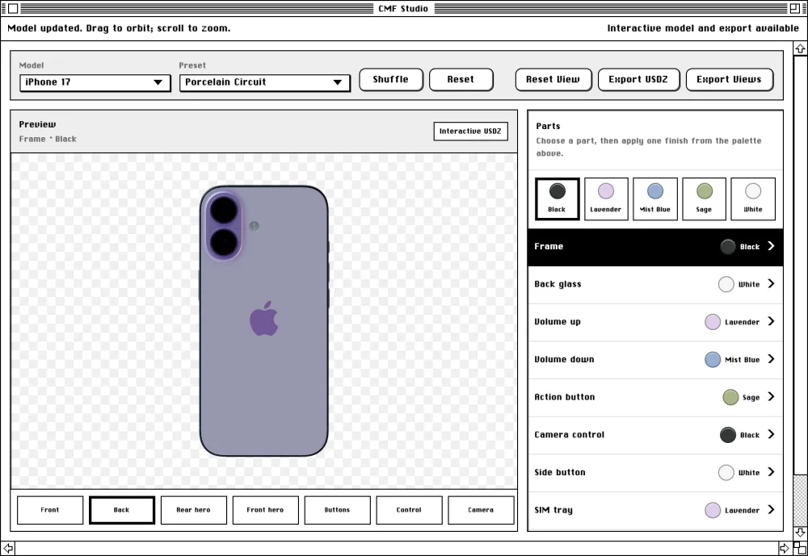 | 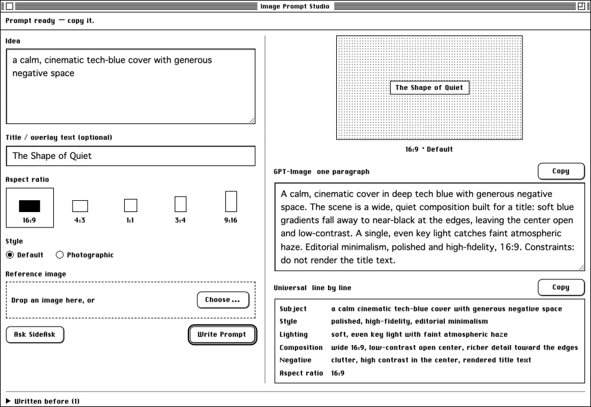 |
| **CMF Studio** — 桌面里的场景编辑器 | **Image Prompt Studio** — 提示词，不是自动驾驶 |

## 一张桌，十二个系统

<table>
<tr>
<td></td>
<td>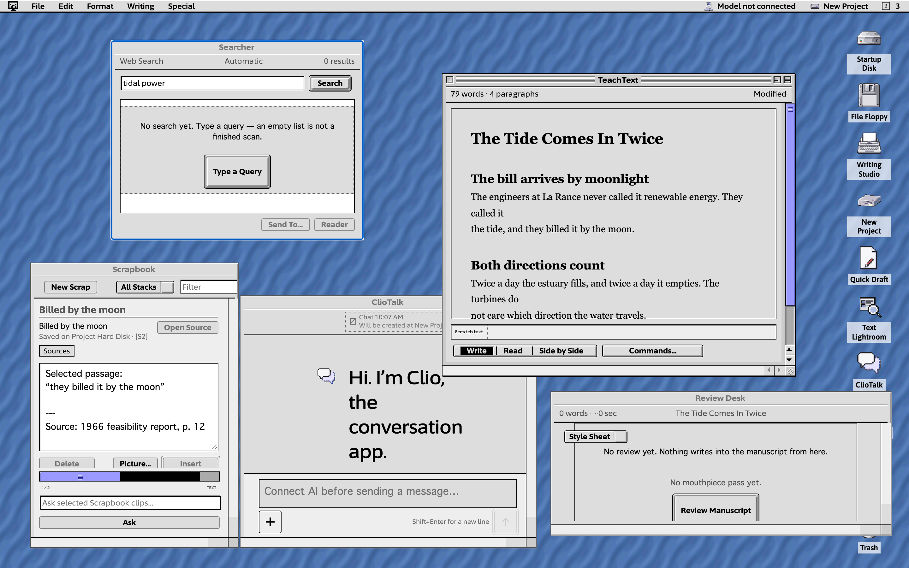</td>
<td>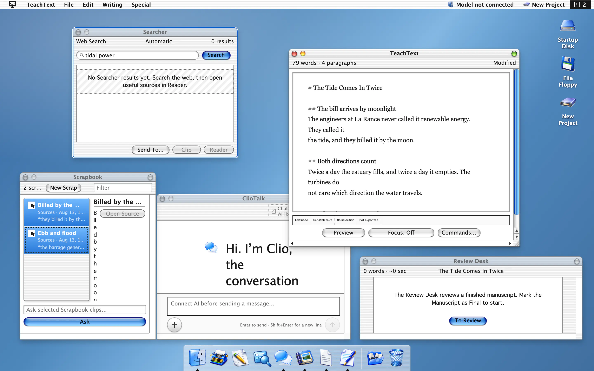</td>
<td>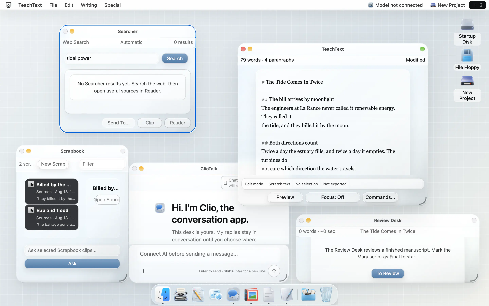</td>
</tr>
</table>

<sub>CLASSIC · PLATINUM · AQUA · LIQUID GLASS——另外八种在<a href="https://aisystem6.aaronlau.me/zh-CN.html">产品官网</a>。</sub>

**Bonsai City** 和 **One More Tune** 是完整应用，不是演示：一座从种子长起来的城镇，和一个建立在真实牌组上的音乐回合。**它还能跑 DOOM**——以及 OpenTTD、Micropolis 和三个更小的游戏——都在同一套窗口模型里。

<p align="center">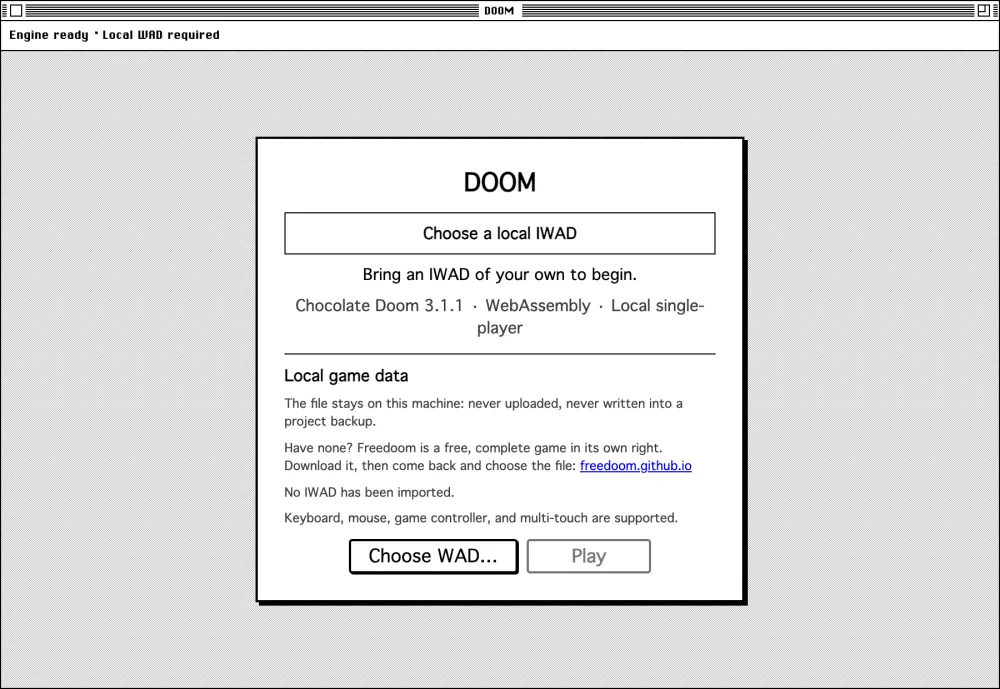</p>

三十六块演示项目盘是一份登记表，不是每块一个文件：
`tooling/build-shared-project-disks.mjs`
是第三块盘必须加入的列表，
`tests/features/launch-intent.test.mjs`
守着源盘与发布副本之间的一致性。

## 在一个 1988 年的约束下建造

```text
启动关键载荷   保持在 System Floppy Budget 之内：2,959,872 字节
两张 1.44 MB 软盘   2,949,120 字节容量，门禁保留一小块余量
重工具   延迟加载，从第三张盘来
```

发布门禁测量启动桌面所需的文件。按需加载的工具、AI 模型和演示盘不计入。`npm run verify:floppy` 会拒绝越过预算的构建；站点从 `site/data/floppy-budget.json` 读取实测大小，这一页不引用它，因为那个数字每次构建都会变。

## 自带模型

| 路线 | 用来做什么 |
| --- | --- |
| **LM Studio** | 本地聊天、嵌入、发现、模型加载 |
| **Ollama** | 本地 OpenAI 兼容服务 |
| **DeepSeek** | 内置云端配置 |
| **自定义端点** | 任何兼容的提供方与模型 |
| **不用模型** | 桌面和所有非 AI 工具 |

持久的项目状态住在浏览器的 IndexedDB 里。服务端是无状态桥，没有应用数据库。凭证不会进入项目文件、聊天、备份或导出。

## 这个仓库怎么保持诚实

声明会腐烂。下面这些从全新克隆运行，失败就拒绝构建。

| 门禁 | 它拒绝发生什么 |
| --- | --- |
| `verify:floppy` | 启动载荷长过两张 1.44&nbsp;MB 软盘 |
| `site:check` | 这一页引用门禁从未测量过的字节数 |
| `verify:docs` | 英文文档与中文镜像漂移 |
| `verify:public` | 这里宣传的命令在全新克隆里失败 |

这一页和[产品官网](https://aisystem6.aaronlau.me/zh-CN.html)上的每一张产品截图，都由 `npm run site:capture-frames`、`npm run site:capture-route` 和 `tooling/capture-site-proofs.mjs` 从运行中的应用重新拍摄。没有手制营销图目录，也就没有会过期的手制营销图。

## 仓库是怎么摆的

```text
AI-System-6/
├── .github/            issue 模板、贡献与安全策略
├── apps/
│   ├── desktop/        浏览器计算机：系统服务、应用、样式、资源
│   └── server/         无状态的 Node.js 桥与模型适配器
├── docs/               架构、开发、更新日志、影片源码
│   └── film/claude-pop/  影片源码、场景时间表与音乐工具
├── platform/           macOS 外壳契约
├── site/               可独立部署的产品官网
├── tests/              可执行的产品与架构契约
├── tooling/            构建、校验、采集、打包、发布
└── vendor/             第三方参考，包括 system.css
```

读[架构](docs/ARCHITECTURE.zh-CN.md)、[开发](docs/DEVELOPMENT.zh-CN.md)、[设计契约](docs/design/DESIGN.zh-CN.md)和[更新日志](docs/CHANGELOG.zh-CN.md)。

## 参与贡献

从 [CONTRIBUTING.md](.github/CONTRIBUTING.zh-CN.md) 开始，用一条可复现的产品契约开 issue，或通过 [SECURITY.md](.github/SECURITY.zh-CN.md) 报告安全问题。这里宣传的每一条命令都必须在全新克隆里工作；公开仓库是一份可独立验证的源码快照。

## 许可证

[MIT](LICENSE)。独立项目——与 Apple Inc. 无隶属关系，也未获其背书。

第三方代码和数据保留自己的许可证。Time Machine 的广告拦截以数据形式发布 uBlock Origin Lite 的规则列表（GPL-3.0）；许可证与来源在 vendor/ubol/。

<div align="center">

  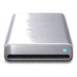 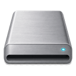 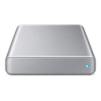 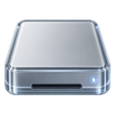

<sub>一块盘。十二种外观。同一份工作。</sub>

如果 AI 写作工具应该放过你的声音，**[★ 给 AI System 6 点个 star](https://github.com/surfine/AI-System-6)**。

[**在线桌面**](https://system6.aaronlau.me)&nbsp;&nbsp;·&nbsp;&nbsp;[**B 站宣传片**](https://www.bilibili.com/video/BV1gYph6hEE6/)&nbsp;&nbsp;·&nbsp;&nbsp;[**产品官网**](https://aisystem6.aaronlau.me/zh-CN.html)&nbsp;&nbsp;·&nbsp;&nbsp;[**最新发布**](https://github.com/surfine/AI-System-6/releases/latest)

</div>

<!-- claim-check: npm run site:check | site/data/floppy-budget.json (bytes 2959134, budget 2959872, written by verify:floppy) | npm run verify:floppy, verify:docs, verify:public | site/img/frames (twelve appearances) -->
